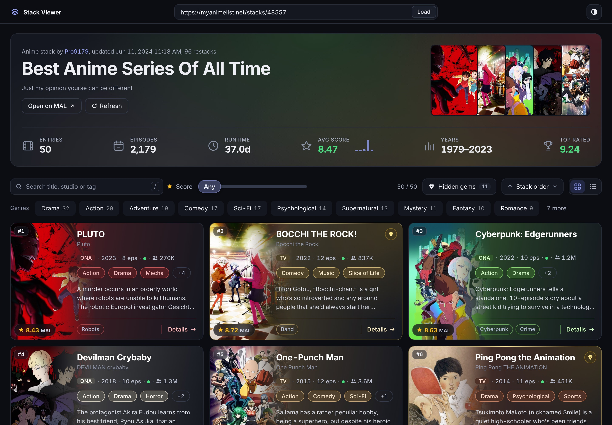

# Stack Viewer

A denser, more informative viewer for [MyAnimeList Interest Stacks](https://myanimelist.net/stacks). Paste a stack link and see every entry's score, genres, studio, runtime, status and synopsis at a glance, then filter the stack down to what you actually want to watch.



**Live demo:** https://myanimelist-stack-explorer.vercel.app/?stack=48557

## Quick start

```bash
node server.js          # no dependencies, needs Node 18+
# open http://localhost:5177/?stack=48557
```

Paste any `myanimelist.net/stacks/<id>` link (anime or manga stacks) into the box at the top, or pass it in the URL as `?stack=<id>`. Set `PORT` to use a different port.

## What you get

- **Stack header:** title, author, description, a poster stack, and an icon bar of totals: entries, episodes, total runtime, average score (with a small score-spread chart), year range and top-rated entry.
- **Entry cards:** a decision preview per entry with poster, rank, MAL score, format, year, episodes, status, members, genres, a short synopsis and the top community tags. Each card's accents take its poster's dominant colour. Titles or studio names that don't fit slide to reveal the rest while you hover or focus a card (skipped if you prefer reduced motion).
- **Pick for me:** one button that picks a random entry from whatever your filters leave and deals it face-down as a mystery card. Tap it and the card charges up and rattles, then flips over in a burst of light and confetti to show the poster, with a quick why (runtime, hidden gem, drop rate). Pick again deals a new one. With reduced motion on, the pick simply appears.
- **Time budget:** a Time menu (an evening, a weekend, a week, a month) that keeps only what fits the time you have, by total runtime.
- **Shareable links:** the Share button copies a link that reproduces your exact view: search, minimum score, genres, sort, cards or table, hidden gems and time budget. The address bar updates as you filter, so any URL is shareable.
- **Filtering:**
  - Search by title, studio, genre or tag (press `/` to jump to the search box).
  - A score slider for the minimum MyAnimeList score, with a histogram of the stack's scores while you slide.
  - Genre pills with live counts, with Match All / Match Any when you pick several.
  - One sort menu (stack order, score, popularity, year, title, total runtime, episodes, drop rate) with Asc/Desc.
- **Commitment risk:** AniList's watch statuses give each entry a drop rate (dropped, as a share of everyone who started it). Entries dropped by 10% or more get a red flag on the poster, every entry's full completed, watching, paused and dropped breakdown is in the detail sheet, and you can sort by it.
- **Hidden gems:** entries rated above the stack's average but with fewer members than its median get a champagne "Hidden gem" pill and a faintly lit card edge. The Hidden gems toggle in the toolbar filters the stack down to just those, and it combines with search, score and genres.
- **Crowd favourite:** the mirror image of a gem. Entries rated above the stack's average and in its most-watched quarter get a Crowd favourite tag, so you can see at a glance which hits are deserved.
- **Views and themes:** cards or table, dark or light, and a layout that works on phones. Cards glide to their new place when you filter or sort, the first load staggers in while the header numbers count up, posters fade in as they load, the detail sheet scales in with its risk bar drawing, and switching theme crossfades; all of it switches off if you prefer reduced motion.
- **Detail sheet:** click a card for the synopsis, air dates, season, studio, source, MAL and AniList scores, all-time and yearly rankings ("#41 highest rated, all time"), links (MyAnimeList, AniList, trailer) and community tags with relevance. Spoiler tags stay hidden until you switch them on. It also shows where to watch (the legal streaming services AniList lists, each with its logo) and a More like this row of titles AniList users recommend; ones that are in the same stack open in place.
- **Quality of life:**
  - Paste a stack link and it loads straight away; no need to press Load.
  - Your last six stacks are remembered in this browser, as chips on the landing page and in the address box's dropdown.
  - In the detail sheet, previous and next arrows (or the `←` and `→` keys) page through whatever your filters leave, with a "3 of 31" counter.
  - Every entry has its own link: the address bar follows the open entry, and the sheet's Copy link button copies a link that opens it.
  - Keyboard shortcuts: `/` search, `P` Pick for me, `←` `→` previous or next entry, `Esc` close, `?` shows the list.
  - A back-to-top button appears once you've scrolled a few screens.

## How it works

1. `lib/stack.js` scrapes the MAL stack page (MAL has no stacks API, and its pages block browser CORS).
2. Every entry is enriched in batches of 50 from the AniList GraphQL API, matched by MAL id: genres, tags, studio, episodes, runtime, status, source, synopsis, trailer, cover, dominant colour, banner, watch statuses, streaming links, rankings and recommendations.
3. Results are cached in `.cache/` for 6 hours. The Refresh button on the stack header bypasses the cache.

The frontend is plain HTML, CSS and JavaScript in `public/`, with no build step.

## Deploying to Vercel

The scraping and caching logic lives in `lib/stack.js`. `server.js` serves it locally, and `api/stack.js` exposes the same `/api/stack` endpoint as a Vercel function (`vercel.json` raises its time limit to 60s). Successful API responses are cached at Vercel's edge for 6 hours. To deploy, import the repo in Vercel or run `npx vercel@latest deploy --prod`; no build settings are needed.

## Caveats

- Scraping depends on MAL's HTML layout; if it changes, `parseEntries` in `lib/stack.js` is the one place to fix.
- A few entries may not exist on AniList; they fall back to MAL-only data.
- Jikan (the usual unofficial MAL API) has no stacks endpoint, and was unreachable from the dev machine.

The screenshot shows stack 48557 ("Best Anime Series Of All Time"). All posters and artwork belong to their respective owners.
